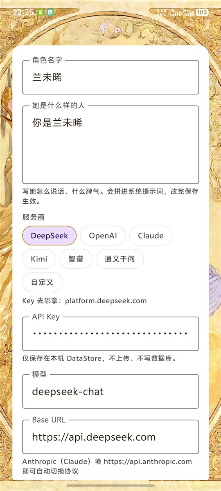

# Ranmiki（兰未晞）

> ## ⚠️ 早期开发阶段，请谨慎使用
>
> **这个应用还在发布早期阶段**，功能仍在快速变化，可能存在导致崩溃、数据丢失或功能不可用的 bug。
> 建议你先用它做轻量体验，**不要把它当作唯一的记录工具**，重要内容记得导出备份（设置 → 备份与恢复）。
>
> 遇到问题、有功能建议、或者觉得哪里不好用，欢迎到 GitHub 提 **Issue**（截图 / 复现步骤 / 机型和系统版本会很有帮助）。
> 你的反馈会直接决定后续怎么做。

一个跑在你自己手机上的私人 AI 工作台：**兰未晞，一个热情、有点黏人、说话很短的 AI 助手**，加上一套她帮你打理的工作台（笔记 / 任务 / 文档 / 提示词 / 复盘）。

不接别人的服务器，不收集数据。你填自己的 API Key，她和她的工具人都直连你自己选的服务商（DeepSeek / OpenAI / Claude / Kimi / 智谱 / 通义千问 / 自定义）。

- 平台：Android（Kotlin + Jetpack Compose + Hilt + Room）
- 最低版本：Android 8.0（API 26）
- 版本：2.0.0（早期发布阶段）
- 许可证：MIT

---

## 这个应用面向谁

- **想要一个「有性格」的 AI 助手**，而不是客服机器人的人：她会顶嘴、会敷衍、会突然换话题，也可以改名、改人设、改说话方式。
- **在意隐私**的人：聊天记录、笔记、任务、文档全部存在本机；唯一的联网是你自己配置的模型服务商。
- **手里有 API Key**、愿意自己配置（DeepSeek / OpenAI / Claude / Kimi 等）的人。
- **想让 AI 帮忙整理工作台**，但担心它乱写数据的人：她写东西必须先进「待审核」，你确认后才进工作台。
- 喜欢折腾主题、插件、本地扩展的 Android 用户。

**它不做什么**：不提供内置模型、不需要注册账号、不上传任何数据、没有社交和推荐。

---

## 主要用途

1. **陪伴式聊天**：和一个有记忆、有前情摘要、有性格设定的角色聊天；可以引用某条消息接着聊。
2. **AI 辅助的个人工作台**：笔记、任务、文档检索、提示词管理、周复盘，都在同一个应用里。
3. **她替你干活**：你说「记一下」，她整理成笔记或任务放进「待审核」；任务到点提醒；她能看到你的笔记和任务并在聊天里顺带提起。
4. **本地扩展**：用 Lua 写插件，给宿主加工具或界面（需要逐项授权）。

---

## 功能详解

### 1. 有性格的对话

- **人设可换**：名字、人设提示词、说话风格都能改；默认人设是一个热情、有点黏人的 AI 助手，不是客服腔。
- **长期记忆**：手动导入 Markdown 记忆（比如你的习惯、偏好），注入时加「只作参考」的护栏，不会被当成指令。
- **长对话压缩**：聊得久了会自动把前面的内容压成摘要（数据库里的 `session_summaries`），不会因为上下文太长而失忆；设置里可以看到摘要数量并导出 Markdown。
- **消息引用**：长按任意消息引用，提示词里带上引用快照；点击引用卡片能跳回原消息。
- **多 Agent 群聊**：她当群主，工具人各配各的模型和 API；一次可以 @ 多人或 @全体，按成员顺序逐个回复；前一个人的回复会进后一个人的上下文。
- **用量统计**：每次对话记录 token 用量（服务商返回 usage 时），设置页显示今天 / 本周用量。

### 2. 工作台

| 模块 | 能力 |
|---|---|
| 笔记 | 新建 / 编辑 / 标签 / 归档 / 搜索 / 导出 Markdown |
| 任务 | 优先级、截止时间、完成勾选、到期通知提醒 |
| 文档 | 导入 txt / md / docx，自动分块存成索引，供她检索 |
| 提示词 | IP / 短视频 / 绘图分类，一键复制 |
| 复盘 | 按周/月汇总产出，最近 4 周趋势图，AI 提议与采纳统计 |
| 待审核 | 她整理的笔记和任务先放这里，确认/修改/驳回后才进工作台 |

### 3. 她替你干活（写入纪律）

- **只在你说了才写**：只有你说「记一下 / 记住 / 好，就这么办」之类的明确指令，她才会提议写入；没让你记的不会自己写。
- **一律先待审核**：所有写入先进待审核队列，你可以修改内容、改截止时间、驳回；已确认的还能撤销（删掉写进去的记录，草稿回到待审核）。
- **查数据走工具**：笔记、任务、文档、提示词都通过工具查询，工具结果带边界标记，避免模型编数字。
- **完成回传**：任务勾选完成后会记一条事件，她下次聊天能提到「最近完成了什么」。
- **到点提醒**：任务截止时发通知，通知抬头带她的名字。

### 4. 多服务商支持

- OpenAI 兼容协议（DeepSeek / OpenAI / Kimi / 智谱 / 通义千问 / 自定义）与 **Anthropic Claude** 协议自动识别（看 BaseURL）。
- 每个工具人可以单独配置服务商、模型、API Key；群聊里各用各的。
- 设置页有服务商预设 chips，点一下自动填 BaseURL 和默认模型。

### 5. 插件系统

- 本地 Lua 插件：`plugin.manifest.json` 声明权限和函数，`main.lua` 写逻辑。
- 权限按项授权（读笔记 / 写笔记 / 网络 / 读全文文档等），**写库、联网等能力会强制弹确认**，插件自声明「不敏感」也绕不过。
- 支持自定义卡片 UI 入口、插件配置项。
- 内置示例插件「工作台速览」可以照着写。

### 6. 视觉与主题

- 三档主题：星夜蓝紫 / 日光金 / 纯净；背景是手绘慕夏风插画（昼/夜两版）。
- 玻璃质感顶栏/底栏，透光程度可调；背景遮罩强度可调。
- 可换角色头像和自己的头像；矢量 / 精细两套图标风格。

### 7. 数据安全

- 所有数据在应用私有目录（Room 数据库 + DataStore），不写外部存储。
- API Key 用 Android Keystore 加密后存 DataStore（`enc:` 前缀）；加密失败不会回退明文；密钥解不开时设置页会提示重填，不会静默清空。
- 备份导出 / 导入：JSON 格式（含笔记、任务、提示词、文档索引、复盘、会话摘要、聊天记录），导入前自动留底。
- 隐私说明见 [PRIVACY.md](PRIVACY.md)。

### 8. 引导与易用性

- 首次启动两屏引导，带连通性测试（真发一次请求验证 Key）；有 Key 的老用户不会被打扰。
- 设置里可以回看引导（预填当前配置）。
- 会话列表按最近活动排序，支持新建 / 删除会话；历史消息可翻页加载（最多 500 条）。

---

## 有什么优点

- **完全本机**：不注册、不上传、无统计 SDK；聊天记录只在你手机里。
- **自带工作台**：聊天 + 笔记 + 任务 + 文档 + 提示词 + 复盘在一个应用里，不用在多个 App 之间复制粘贴。
- **写入可控**：AI 写数据必须经过待审核，避免「她偷偷改了你的笔记」。
- **模型自由**：任何 OpenAI 兼容服务商都能接，也能接 Claude；换服务商不用换应用。
- **可扩展**：Lua 插件 + 权限体系，能自己加工具和界面。
- **长对话不失忆**：自动摘要 + 历史引用，聊很久也能接上。
- **开源**：MIT 许可证，代码可读、可改、可自己编译。

---

## 截图

| 会话列表 | 聊天（群聊） | 待审核 |
| --- | --- | --- |
|  |  |  |

| 复盘 | 设置 |
| --- | --- |
|  |  |

---

## 早期阶段说明（请读）

这是**第一次公开发布**，目前的状态：

- 核心链路（聊天、工作台、待审核、备份、插件）可用，但边缘场景可能还有 bug。
- 界面和功能还会调整，**不保证向后兼容**；升级前建议先导出备份。
- 文档还在补：README 截图是最新的，开发记录在 [docs/DEVLOG.md](docs/DEVLOG.md)。
- 测试覆盖：584 个单元测试全绿，但真机机型覆盖有限（主要在 vivo / Android 15 上验证）。

**反馈渠道**：GitHub Issues。请尽量附上：

- 复现步骤（点了哪里、发生了什么、期望是什么）
- 手机型号 + Android 版本
- 如果崩溃，设置 → 诊断 → 导出崩溃日志（只在本机，不上传）

已知的、暂时不打算做的：iOS 版本、内置模型、云同步。

---

## 构建

环境：

- JDK 17
- Android SDK：platform 35、build-tools 35
- **工程路径必须是纯 ASCII**（AGP 不接受非 ASCII 路径）

```bash
# 调试包
./gradlew :app:assembleDebug
# 输出：app/build/outputs/apk/debug/app-debug.apk

# 正式包（需要签名，见下）
./gradlew :app:assembleRelease
# 输出：app/build/outputs/apk/release/app-release.apk
```

### 发布签名

仓库里不含密钥。新建根目录 `keystore.properties`（已在 `.gitignore` 里）：

```properties
storeFile=keystore/your-release.jks
storePassword=你的密码
keyAlias=你的别名
keyPassword=你的密码
```

密钥用 `keytool` 生成：

```bash
keytool -genkeypair -v -keystore keystore/your-release.jks \
  -alias youralias -keyalg RSA -keysize 2048 -validity 10000 \
  -dname "CN=YourName, OU=Mobile, O=YourOrg, C=CN"
```

没有 `keystore.properties` 时 `assembleRelease` 会退回 debug 签名，本地照样能跑。

---

## 隐私

**数据都在本机。** 不收集、不上传、没有统计和广告 SDK；API Key 用系统 Keystore 加密保存。
唯一联网场景是你发消息时，内容直接发给你自己配置的服务商。

完整说明：[PRIVACY.md](PRIVACY.md)

---

## 项目结构

```
app/              单 Activity + Navigation Compose + Hilt 装配
core/design/      慕夏主题、玻璃栏、图标、通用组件
core/data/        Room、仓储、插件宿主、会话摘要、备份
core/network/     OpenAI 兼容 + Anthropic 流式客户端、连通性探针
domain/prompt/    提示词拼装、AgentProfile、群会话
domain/plugin/    插件契约与权限表
domain/docs|tools/ 文档分块、工具契约
feature/          功能模块：chat / notes / tasks / docs / prompts / review / inbox / settings / plugins / search / onboarding
```

---

## 文档

| 文件 | 内容 |
|---|---|
| [docs/DEVLOG.md](docs/DEVLOG.md) | 逐卡开发记录（P001 至今，含每轮验收细节） |
| [HANDOFF.md](HANDOFF.md) | 交接文档：架构关键决策、踩过的坑、下一步 |
| [ROADMAP.md](ROADMAP.md) | 待办与悬而未决 |
| [NEXT-SESSION.md](NEXT-SESSION.md) | 下一会话的开工自检与交接提示词 |

---

## 许可证

[MIT](LICENSE)
